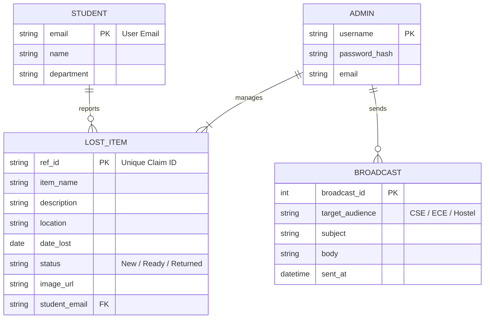

incomplete
Broadcast= attached.CSB files


---

<div align="center">

  <a href="https://www.jisgroup.org">
    
  </a>

  # 🎓 Smart Lost & Found Portal
  
  ### *Digitalizing Campus Security & Item Recovery*

  <p align="center">
    <a href="https://github.com/yourusername/jis-lost-found/issues">
      
    </a>
    <a href="https://github.com/yourusername/jis-lost-found/pulls">
      
    </a>
    <a href="https://github.com/yourusername/jis-lost-found/stargazers">
      
    </a>
    <a href="https://github.com/yourusername/jis-lost-found/blob/main/LICENSE">
      
    </a>
  </p>

  <br/>

  <h3>
    <a href="#-overview">📖 Documentation</a>
    <span> | </span>
    <a href="#-installation--setup">🚀 Installation</a>
    <span> | </span>
    <a href="#-api-endpoints">📡 API Reference</a>
  </h3>

</div>

<div align="center"> 
  
  **Built With:**
  
  
  
  
  
  
  
</div>


---

## 📖 Overview

The **JIS University Lost & Found Portal** is a comprehensive full-stack web application designed to digitalize and streamline the recovery of lost items on campus. 

By bridging the gap between **Students** and the **Administration (Librarian)**, the system ensures faster item recovery through automated email communication, QR code verification, and a centralized management dashboard.

---

## ✨ Key Features

### 🏛️ For the Administration (Librarian)
* **📢 Smart Broadcast System:** Send targeted email alerts to specific groups (e.g., *CSE Dept*, *Hostelers*) when an item is found.
* **📊 Data Export Center:** Filter records by date or status and export official reports as **CSV files**.
* **🛡️ Secure Dashboard:** A Glassmorphism-styled control center to manage inventory.
* **🔍 QR Verification:** Verify ownership instantly by scanning the student's email QR code.

### 🎓 For Students
* **📝 Easy Reporting:** Report lost items with details and image uploads.
* **📧 Automated Receipts:** Receive an instant email confirmation containing a **unique QR Code** and Ref ID.
* **📱 Mobile Responsive:** Accessible on any device for quick reporting on the go.

---

## 🛠 Tech Stack

| Component | Technology | Usage |
| :--- | :--- | :--- |
| **Frontend** | HTML5, CSS3 | Glassmorphism UI, Responsive Grid Layout |
| **Logic** | JavaScript (ES6+) | DOM Manipulation, Fetch API, Animation Logic |
| **Backend** | Node.js | Runtime Environment |
| **Framework** | Express.js | REST API Routing |
| **Services** | Nodemailer | SMTP Email Automation (Gmail) |
| **Utils** | QRCode.js | Generating Verification QR Codes |

---

## 📸 Screenshots

| **Admin Dashboard** | **Broadcast Center** |
|:---:|:---:|
|  |  |

| **Export Data** | **Email Notification** |
|:---:|:---:|
|  |  |


---

## 🎥 Project Demo

Watch the full walkthrough of the **JIS Lost & Found Portal** in action. This video demonstrates the reporting process, the admin dashboard, and the email alert system.

<div align="center">
  <video src="PASTE_YOUR_NEW_GITHUB_LINK_HERE" controls="controls" width="600" style="border-radius: 10px; box-shadow: 0px 4px 12px rgba(0,0,0,0.3);"></video>

  <p style="margin-top: 10px;">
    <em>🎥 Live Project Walkthrough (Click Play)</em>
  </p>
</div>

---

## 🚀 Installation & Setup

### 🔐 Configuration & Credentials

To send emails securely, you must configure a **Google App Password**.
### 1. 💻 Create the `.env` File
Navigate to the `Backend` folder and create a new file named `.env`. Add the following lines:

```env
EMAIL_USER=your-email@gmail.com
EMAIL_PASS=xxxx xxxx xxxx xxxx
```

### 🛡️ How to Generate a Google App Password  (STEPS)

Since Google requires secure authentication for third-party apps, you cannot use your regular Gmail password. Follow these steps to generate a secure **App Password**:

1.  **Go to Google Account:** Click on your profile and select **Manage your Google Account**.
2.  **Security Settings:**
    * Navigate to the **Security** tab on the left.
    * **Crucial:** Ensure **2-Step Verification** is turned **ON**.
3.  **Find App Passwords:**
    * In the search bar at the top, type **"App passwords"**.
    * Click on the **App passwords** result.
4.  **Create New App:**
    * **App Name:** Type `NodeMailer` (or your project name).
    * Click **Create**.
5.  **Get Your Password:**
    * Google will generate a 16-character code (e.g., `abcd efgh ijkl mnop`).
    * **Copy** this code.
    * **Paste** it into your `.env` file: `EMAIL_PASS=abcd efgh ijkl mnop`

> **⚠️ Security Note:** Never share your `.env` file or commit it to GitHub. It contains sensitive credentials.
### 2. 💻 Terminal Installation Guide

Follow these steps in your command line interface (Terminal / CMD / PowerShell) to set up the backend.

**Navigate to the Directory on Terminal**
Move into the backend folder where your server files are located: (TERMINAL)
```bash
cd Frontend\Backend
npm init -y
npm install express nodemailer cors body-parser qrcode dotenv
node server.js
```

---

### Clone the Repository
```bash
git clone https://github.com/amitpaul2004/UNIVERSITY---lost--found-.git
cd jis-lost-found
```
---

## 🗄️ Database Schema (ER Diagram)

The following diagram illustrates the logical structure of data within the application, highlighting the relationships between Students, Lost Items, and the Admin system.




